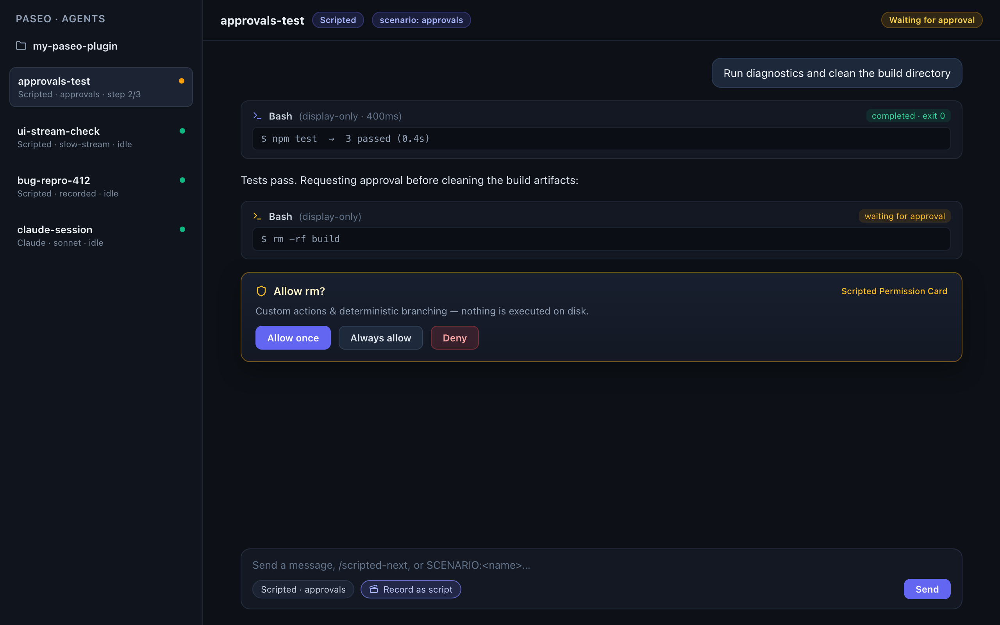
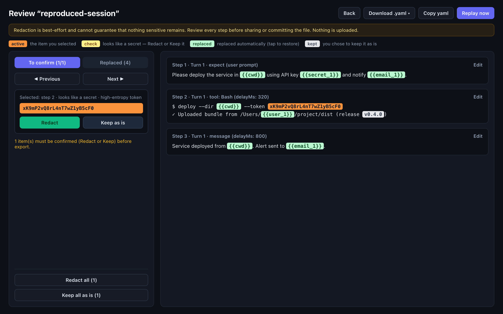
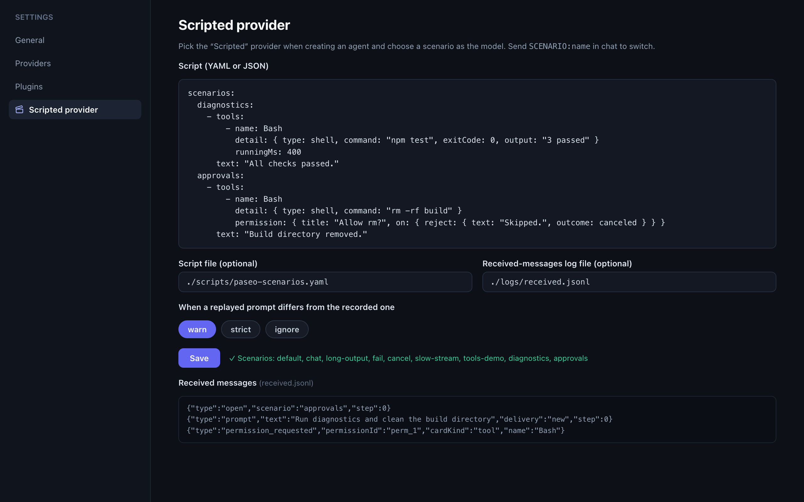

[](https://github.com/quickwind/paseo-scripted-provider/actions/workflows/ci.yml)
[](https://github.com/quickwind/paseo-scripted-provider/actions/workflows/ci.yml)
[](https://github.com/quickwind/paseo-scripted-provider/actions/workflows/ci.yml)
[](https://github.com/quickwind/paseo-scripted-provider/actions/workflows/security.yml)
[](https://www.npmjs.com/package/paseo-scripted-provider)
[](LICENSE)
[](#兼容性)

**语言：** [English](README.md) | 简体中文

# paseo-scripted-provider

<p align="left">
  
  <strong>面向 <a href="https://paseo.sh">Paseo</a> 的确定性、无模型 Agent 后端。</strong><br/>
  基于 YAML/JSON 脚本回复，支持测试真实权限卡片与流式时间线、录制真实会话并自动脱敏密钥、在 CI 中运行隔离的端到端测试——零 LLM 调用、零 API Key。
</p>

<br clear="left"/>

## 为什么选择 Scripted Provider？

直接调用真实 LLM 来测试 Agent UI、各类 Paseo 插件或 CI 流水线往往既慢又贵，还难以稳定复现边界情况。**Scripted Provider** 为你提供一个行为与真实 Agent 一致、但完全确定性的 Paseo 后端：

- **手动测试各类 Paseo 插件与 UI** — 精确控制长输出、分块流式输出、思考过程（Reasoning）、工具调用失败/取消以及多按钮权限卡/问答卡，适合验证时间线渲染器、生命周期钩子、权限自动化插件和各类面板 UI。
- **录制并脱敏真实 Bug 现场** — 将 Claude、Codex 或 OpenCode 的真实对话一键录制成可回放的 YAML/JSON 脚本，自动识别并脱敏密钥与路径（`{{secret_N}}`、`{{cwd}}`、`{{email_N}}`），无需 API Key 即可在任意环境复现。
- **在 CI 中对真实 Paseo Daemon 运行快速可重复的端到端测试** — 配合内置的 [`paseo-scripted-provider-testkit`](#testkit)，在 Linux、macOS 和 Windows 上以隔离状态和动态端口拉起真实守护进程。
- **安全设计** — 脚本中的工具调用（`tools[]`）仅用于界面展示，绝不会在本地磁盘或 Shell 中实际执行任何命令。

## 界面演示

### 确定性回复、工具调用与交互式权限卡片
支持流式分块输出、仅展示型工具调用，以及带有自定义按钮和条件分支（`allow` / `deny` / `answer:<value>`）的真实 Paseo 权限卡片：



### 一键录制真实会话与密钥脱敏审查
在桌面端或网页端点击输入框旁的 **录制为脚本**（场记板图标），即可将真实对话转为带时序的脚本，逐项确认高熵 Token，并导出 YAML/JSON 或点击 **立即回放**：



### 实时脚本编辑器与消息接收日志
在 **设置 → Scripted provider** 中配置内联 YAML/JSON 脚本、外部脚本文件路径、提示词对齐模式（`warn` / `strict` / `ignore`），并直接查看 `received.jsonl` 日志尾部：



## 安装

需要 Paseo `>=0.11.0`（无上限限制；简体中文与英文界面翻译需要 Paseo 0.13+，旧版本自动回退为英文），且须在守护进程配置中启用插件（在 `config.json` 顶层设置 `"pluginsEnabled": true`，否则 `paseo plugin install` 后插件会保持禁用状态）。

通过 Paseo CLI 安装：

```bash
# 从 npm 安装已发布版本
paseo plugin install npm:paseo-scripted-provider

# 或从源码安装
git clone https://github.com/quickwind/paseo-scripted-provider
paseo plugin install ./paseo-scripted-provider
```

`npm:` 前缀用于明确告知 CLI 来源为 npm 包；发布包与 GitHub Release 版本号一致。守护进程会自动编译插件，无需手动构建。

## 快速开始

1. 新建 Agent，Provider 选择 **Scripted**，Model 选择一个场景（如 `chat`、`long-output`、`fail`、`cancel`、`slow-stream`、`tools-demo`、`default` 或你自己的场景）。
2. 发送消息。每条消息都会将场景推进一条回复；到达末尾后会重复最后一条回复。
3. 在对话中发送 `SCENARIO:<名称>` 可中途切换场景（该消息会立即收到新场景的第一条回复）。

打开 **设置 → Scripted provider** 可以粘贴内联脚本、指定外部脚本文件、设置接收消息日志文件路径，并查看脚本校验错误（即使脚本格式有误也不会破坏 Provider，内置场景始终可用）。

斜杠命令快捷方式：`/scripted-next` 会发送 `(next)` 推进一步；`/scripted-reset [场景名]` 会发送 `SCENARIO:<场景名或当前模型>` 重置场景。

### 内置场景

即使不配置任何自定义脚本，以下内置场景也始终开箱即用：

| 场景名称 | 行为说明 |
|---|---|
| `default` | 返回单条纯文本回复（`"plain default reply"`） |
| `chat` | 3 轮多回合对话（末尾重复最后一句） |
| `long-output` | 输出 200 行文本，用于测试滚动条与长文本渲染 |
| `slow-stream` | 每隔 `400ms` 流式输出一个文本块 |
| `tools-demo` | 展示一个成功的 `Bash`（`exitCode: 0`）和一个失败的 `Edit`（`conflict`）工具调用及总结 |
| `fail` | 延迟 `300ms` 输出部分文本后以 `outcome: failed` 结束 |
| `cancel` | 立即以 `outcome: canceled` 结束 |

## 脚本格式

脚本支持 **YAML** 或 **JSON**（自动识别）。每个场景是一组按顺序排列的回复列表；推荐编写 YAML，可读性更好，支持多行字符串（`|`）与注释。

```yaml
macros:
  SUMMARY_HEADER: |
    ### Diagnostics & Health Check
    Scanning project structure...
scenarios:
  # 场景 1：包含模拟工具执行的多回合流程
  diagnostics:
    - text: "@SUMMARY_HEADER"
    - tools:
        - name: Bash
          detail: { type: shell, command: "npm test", exitCode: 0, output: "3 passed" }
          runningMs: 400
          status: completed
        - name: Edit
          detail: { type: edit, filePath: "src/a.ts" }
          status: failed
          error: conflict
      text: "Tests pass; the edit conflicted."

  # 场景 2：模拟流式分块输出
  stream-demo:
    - chunks: ["Analyzing repo... ", "Found 3 files. ", "All clean!"]
      chunkDelayMs: 250

  # 场景 3：复现失败或超时
  timeout-demo:
    - text: "Connecting to remote registry..."
      startDelayMs: 1500
      outcome: failed
      error: "Connection timed out"

  # 场景 4：带时序的步骤（录制会话导出格式）
  recorded:
    - expect: "deploy the service"
      steps:
        - { kind: reasoning, text: "Checking the deploy script...", delayMs: 1200 }
        - kind: tool
          delayMs: 300
          tool:
            name: Bash
            detail: { type: shell, command: "npm run deploy", exitCode: 0, output: "ok" }
        - { kind: message, text: "Deployed.", delayMs: 800 }
```

### 时序步骤（Timed steps）

一条回复可以使用 `steps` 列表替代聚合字段（`text` / `messages` / `tools`）。每个 step 会先等待自身的 `delayMs` 再发出，因此录制的会话可以完整保留原始节奏——包括思考耗时、每个工具调用和每条消息的间隔时间。

`kind` 支持 `reasoning`、`message`、`tool`、`permission`、`parallel`、`todo`、`compaction`（支持 `runningMs` 模拟 `loading` → `completed`）、`notification`、`error`、`plugin`（`timeline.plugin` 自定义卡片）、`usage` 与 `notice`；`message` 和 `reasoning` 步骤同样支持 `chunks` + `chunkDelayMs` 流式输出；`delayMs` 与 `revertToken` 均为可选项。手写脚本依然可以直接使用更简洁的 `text` / `chunks` / `messages` / `tools` 字段。

| 回复字段 | 含义 |
|---|---|
| `text` | 一条完整的助手消息 |
| `chunks` + `chunkDelayMs` | 按块流式输出同一条消息（相同 message id，文本逐步增长） |
| `messages` + `toolBetween` | 多条独立消息，可选在消息之间插入一次工具调用 |
| `reasoning` | 回复前的思考过程（Reasoning）条目 |
| `tools[]` | 仅展示型工具调用：`name`、`detail`（Paseo 工具详情对象：`shell`、`read`、`edit`、`write`、`search`、`fetch`、`plain_text` 等）、`status`（`running`/`completed`/`failed`/`canceled`）、`runningMs`、`error`。**不会真正执行任何命令。** |
| `startDelayMs` / `delayMs` | 回复开始前 / 回合结束前的等待时间（便于复现竞态条件） |
| `outcome` | `completed`（默认）、`failed`、`canceled` 或 `hang`（保持运行直至被中断） |
| `error` / `errorCode` / `diagnostic` / `runtimeFailed` | 错误信息、自定义错误码（如 `quota_exceeded`）、诊断详情以及是否发射 `session.runtime_failed` |
| `usage` / `notices` | 发射 `session.usage`（Token、费用、上下文窗口）与 `session.notice` 横幅通知 |
| `onSteer` | 回合运行中收到 `delivery: "steer"` 插话时执行的分支（不取消当前回合，支持 `{{steer.text}}`） |
| `expect` | 该步骤期望的用户输入（录制脚本会自动生成）；见下方*对齐模式* |
| `@NAME` | 当 `text`/`chunks`/`messages` 的整串值等于 `@NAME` 时展开宏 `NAME`（权限分支内同样适用） |

顶层脚本配置项：支持 `onExhausted`（`"repeat"` 默认、`"fail"` 触发 `E_SCRIPT_EXHAUSTED`、或 `"cycle"` 循环）、`modes`、`defaultMode`、`thinkingOptions`、`defaultThinkingOption`、`controls` 以及 `commands`（通过 `catalog`、`session.config`、`session.commands` 与 `session.configure` 实时联动，且支持权限分支内 `setMode` 自动切换模式）。

模板变量反水合：发射时间线与权限卡时会自动将 `{{cwd}}` 反水合为当前会话工作目录，并支持 `{{prompt.text}}`、`{{session.cwd}}`、`{{session.model}}`、`{{session.mode}}`、`{{session.thinkingOption}}`、`{{steer.text}}` 与 `{{permission.updatedInput.<key>}}`（脱敏占位符如 `{{secret_1}}` 原样保留）。

非法脚本、未知场景名或格式错误的工具详情都不会卡死回合：Provider 会回退到内置场景（并在设置页显示具体错误）。所有工具 `detail` 对象在加载脚本时均会按 Paseo SDK 的结构进行校验。

运行行为说明：中断操作会使当前回合以 `canceled` 结束；回合运行期间收到 `delivery: "auto"` 新消息会取代旧回合（旧回合仅取消一次），收到 `delivery: "steer"` 则吸收进当前回合（并支持 `clearPendingPermissions`）；未知场景名会回退到 `default`；守护进程重启后会以 `version: 2` 快照完整恢复所有时间线项；配置 `delayScale: 0`（或环境变量 `SCRIPTED_PROVIDER_DELAY_SCALE=0`）可在 CI 中以毫秒级跑完带真实延迟的录制脚本。

**对齐模式（Alignment）**：当步骤配置了 `expect` 且实际输入不同步时 —— `warn`（默认）记录一条 `mismatch` 日志并继续；`strict` 以错误码 `E_SCRIPT_MISMATCH` 失败该次请求；`ignore` 不作检查。

### 权限卡片（Permission cards）

脚本回复可以暂停并弹出**真实的** Paseo 权限卡片，等待用户或自动化插件响应后按不同分支继续执行，但同样不会真正执行任何操作（同意仅改变工具在界面上的显示状态）：

- **绑定在工具上**（`tools[]` 或 `tool` step 中添加 `permission`）：工具先显示为运行中并弹出卡片；允许后工具按 `runningMs` 完成，拒绝后工具标记为失败（`denied`）。
- **独立权限卡片**：使用 `{ kind: permission, permission: {...} }`，可配置 `questions`（AskUserQuestion 问答卡）、`plan`（方案审批卡）或 `kind: mode` / `kind: other`。
- **并行多卡**：使用 `{ kind: parallel, steps: [...] }` 同时展示多个 `tool` 与 `permission` 卡片，各自响应后按声明顺序执行分支。

分支匹配优先级（最先命中者生效）：按钮 ID（`selectedActionId`，默认按钮为 `accept` 与 `reject`）→ 问答答案（`answer:<header>=<value>` / `answer:<value>`）→ `allow` / `deny` → `any`。分支文本与错误支持模板变量：`{{permission.behavior}}`、`{{permission.action}}`、`{{permission.message}}`、`{{permission.answer}}` 及 `{{permission.answers.<header>}}`；其他 `{{…}}`（如脱敏占位符 `{{secret_1}}`、`{{cwd}}`）原样保留。

## 接收消息日志

在设置中指定日志文件（或通过环境变量 `SCRIPTED_PROVIDER_STATE=<dir>` 运行，自动使用 `<dir>/scenarios.json` 与 `<dir>/received.jsonl`）。每行一条 JSON 记录，涵盖 `open`（完整记录 `cwd`、`env`、`systemPrompt`、`mcpServers`、`toolPolicy`、`mode`、`thinkingOption`、`providerOptions`、`settings`、`title`）、`prompt`（含附件摘要 `attachments`、`command`、`outputSchema`、`clearPendingPermissions`、`steeredTurnId`）、`configure`、`close`、`interrupt`、`mismatch`、`exhausted`，以及权限卡相关事件 `permission_requested`、`permission_response`（含 `updatedInput` 与 `updatedPermissions`）、`permission_canceled`、`permission_unknown`。可在测试中直接断言，或在设置页查看最新日志。

## 录制会话为脚本

每个对话输入框旁都会出现 **录制为脚本** 按钮（场记板图标），用于录制当前对话。

> **仅限桌面端与网页端。** 审查界面包含长步骤列表、逐项敏感值确认、内联编辑和文件下载，iOS 端不注册该入口与页面；插件的其余功能（设置、`/scripted-next`、`/scripted-reset`、Provider 本身）在 iOS 端均可正常使用。

1. 设置脚本名称、最近回合数、延迟处理方式（保留 / 按倍数缩放 / 移除）、是否包含思考过程与工具输出，以及截断长度。选择**保留**时会通过[时序步骤](#时序步骤timed-steps)完整还原思考、工具与消息的真实耗时。
2. **预览与脱敏**：系统会自动高亮并替换常见敏感信息（AWS `AKIA`/`ASIA` 密钥、GitHub Token、`sk-…`、Google API Key、npm/GitLab Token、Slack Token、JWT、PEM 私钥、`Bearer`、URL 密码、邮箱、`/Users/x` / `/home/x` / `C:\Users\x` 用户名及当前工作目录 `{{cwd}}`）。未命中规则的高熵字符串会以黄色高亮列出且**绝不自动修改**，必须手动确认 **脱敏** 或 **保留** 后才能解锁导出。
3. 选择 **YAML**（默认）或 **JSON**，点击 **下载**、**复制**，或点击 **立即回放** 直接保存场景到设置并打开一个运行该脚本的 Scripted Agent。

> **脱敏为尽力而为（Best-effort）。** 无法保证识别所有业务机密、人名或客户数据。分享或提交脚本前请务必逐行检查。插件不会向任何外部服务器上传数据。

## Testkit

[`testkit/`](testkit/) 是一个纯 Node.js（无 Shell 依赖、兼容 Windows）辅助包 `paseo-scripted-provider-testkit`，用于在 CI 或单元测试中启动隔离的 Paseo 守护进程、安装插件并驱动 Agent。完整示例见 [`e2e/scripted.e2e.test.mjs`](e2e/scripted.e2e.test.mjs)。

```bash
npm install -D paseo-scripted-provider-testkit
```

```js
import { startScriptedEnv } from "paseo-scripted-provider-testkit";

const env = await startScriptedEnv({ script: { scenarios: { hi: [{ text: "hello" }] } } });
const agent = await env.createAgent({ scenario: "hi", prompt: "x" });
await env.waitForFinish(agent.id);
console.log(env.readRecord()); // 解析后的 received.jsonl
await env.stop();
```

`testkit` 会自动分配空闲端口、使用临时 `--home` 与隔离环境变量，绝不会污染本地 `~/.paseo`。

## 兼容性

| Paseo 版本 | 状态 |
|---|---|
| 0.12.x – 0.16.x（CI 实测 0.16.2，支持动态能力协商） | 支持 |
| 更高版本 | 版本范围允许，不作保证 |
| 其他版本 | 未测试 |

CI 在 Ubuntu、macOS 和 Windows 上均会针对固定的 Paseo 版本（`0.16.2`）运行真实守护进程 E2E 测试。

## 本地开发

```bash
npm ci
npm run typecheck
npm test                 # 单元测试 + 集成测试 (vitest)
npm run test:coverage    # + 覆盖率门禁 (90% lines) → reports/
npm ci --prefix testkit && npm run e2e     # 真实 Paseo 守护进程 E2E
npm run verify:package   # 校验 npm 发布包内容
npm run check:client-bundle && npm run check:hermes
```

## 开源协议

[MIT](LICENSE) © 2026 quickwind
